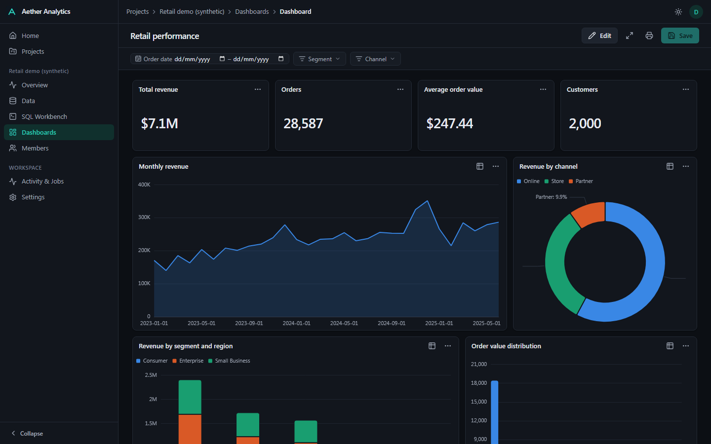
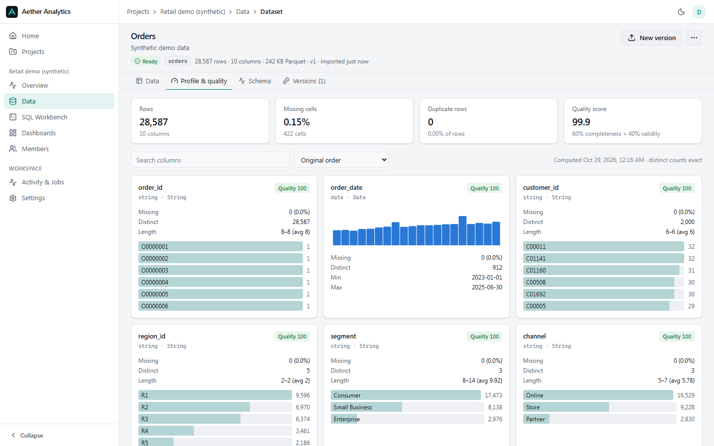
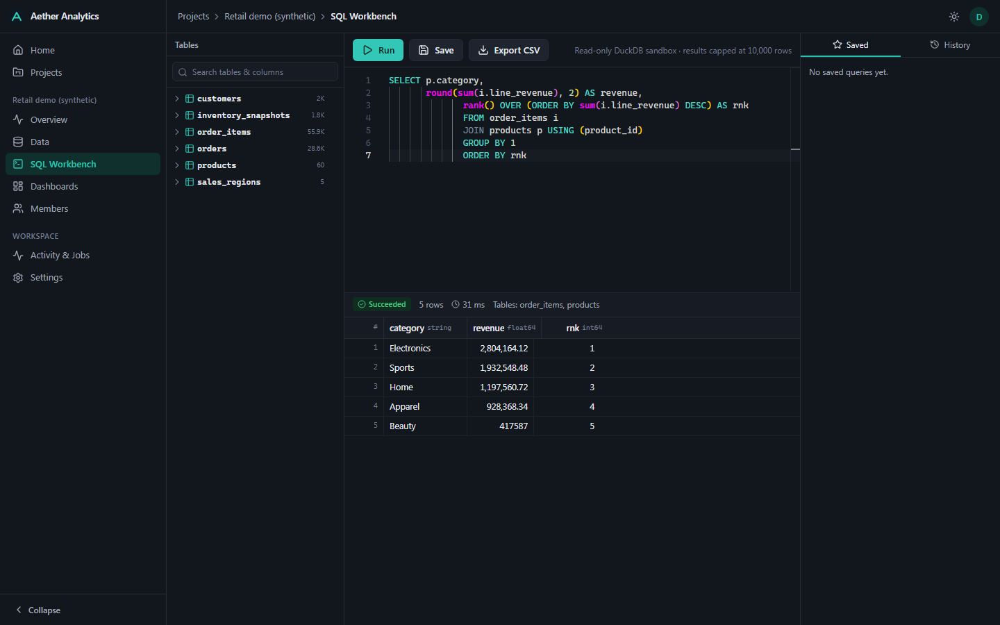

# Aether Analytics

A local-first business intelligence platform. Import data files, inspect their quality, query
them with SQL, and build interactive dashboards. Everything runs and is stored on your own
machine; no cloud services, paid APIs or AI models are required.



| Data profiling | SQL workbench |
|---|---|
|  |  |

*Screenshots use the built-in synthetic demo dataset (all names and figures are fictitious).*

## What works today

| Area | Capabilities |
|---|---|
| **Landing & sign-in** | Public landing page for visitors (features, workflow, security, real product screenshots); split-layout sign-in / registration with show/hide password and a strength meter; deep links still require sign-in |
| **Projects** | Create, rename, search, archive and restore, delete with confirmation; overview built from real metadata (datasets, dashboards, queries, quality, activity, jobs); member roles (viewer / editor / owner) |
| **Ingestion** | CSV/TSV (delimiter sniffing, encodings, header and null markers, skip rows), Excel `.xlsx`/`.xls` with sheet picker, JSON arrays / NDJSON / single-array documents (nested objects flattened), Parquet. Files are validated **by content**, not just extension. Preview with type overrides before import. Imports run as background jobs. |
| **Schema inference** | Integer, float, decimal, boolean, date, timestamp and string. Dates are only parsed when **every** value matches **one** unambiguous format, so ambiguous `05/01/2024` stays text, with a warning. Type overrides are strict: failing values abort with counts and examples instead of becoming silent nulls. |
| **Datasets** | Immutable, versioned Parquet snapshots with SHA-256 content hashes; re-import creates a new version; version history; server-side paginated explorer with multi-column sort, filters, column visibility and CSV export; rename; delete is blocked while dashboards depend on the dataset |
| **Profiling & quality** | Per column: missing %, distinct (exact, or HyperLogLog above 2M rows), min/max, mean, median, std, quantiles, histograms, top values, IQR outliers, infinite/NaN counts, blank strings, non-numeric values in mostly-numeric text columns; duplicate rows; per-column and dataset quality scores with plain-language issues |
| **SQL workbench** | Monaco editor bundled locally (works offline) with schema-aware completion, schema browser, run/cancel, Ctrl+Enter, bounded results, duration and row count, history, saved queries, CSV export, autosaved drafts |
| **SQL security** | sqlglot AST validation (single read-only query; only approved tables; no table functions, file paths, qualified names or I/O/introspection functions), **plus** a DuckDB sandbox per query: only that query's Parquet files are readable, external access is disabled, configuration is locked, and memory, thread and time limits apply |
| **Dashboards** | Drag-and-drop, resizable grid; KPI, bar, stacked bar, line, area, pie, donut, scatter, histogram, box plot, heatmap and table widgets; per-widget configuration (dimension, date grouping, breakdown, multiple measures, aggregation, sort, limit, nulls, number format, axis labels, colour, legend, labels); global date-range and category filters; click-to-cross-filter; table view for every chart; query and lineage view (source dataset and version, generated SQL); PNG export; full-screen presentation; print / save as PDF; duplicate; unsaved-change protection |
| **Jobs** | Durable DB-backed queue (survives restarts, stale-job recovery), progress, cancellation, user-readable errors, live status indicator |
| **Platform** | Session auth (Argon2id, HttpOnly cookies, CSRF tokens), per-request project authorization, audit log, structured JSON logs with request IDs, health/readiness endpoints, OpenAPI docs, dark/light themes, keyboard-accessible UI, backup/restore, benchmark suite, deterministic demo data |

**Not implemented yet:** visual ETL pipelines, statistical tests, forecasting, anomaly
detection, report builder, data-quality rules, the optional local AI assistant, and full
lineage graphs. These routes are deliberately absent from the UI rather than shown as
placeholders. See [docs/ROADMAP.md](docs/ROADMAP.md).

## Architecture in one paragraph

A modular monolith. **FastAPI** (`apps/api`) handles auth, authorization, metadata (SQLAlchemy
and Alembic on **PostgreSQL**, or **SQLite** for single-user use) and coordinates the analytics
engine: **Polars** for ingestion and profiling, and **DuckDB** over immutable **Parquet** files for
SQL and chart queries. Long-running work goes through a database-backed job queue processed by
a worker, either embedded in the API process or run separately. The **React + TypeScript** SPA
(`apps/web`) uses TanStack Query, ECharts, Monaco and react-grid-layout. Details are in
[docs/ARCHITECTURE.md](docs/ARCHITECTURE.md).

## Requirements

- Python 3.12+ and [uv](https://docs.astral.sh/uv/)
- Node.js 20+ and [pnpm](https://pnpm.io/) 10
- Optional: PostgreSQL 16 (otherwise SQLite is used automatically), Docker

## Quick start (single process, SQLite)

```bash
# 1. Backend dependencies
cd apps/api
uv sync

# 2. Build the web app (the API serves it)
cd ../web
pnpm install
pnpm build

# 3. Migrate and start: http://127.0.0.1:8000
cd ../api
uv run aether serve
```

Open http://127.0.0.1:8000, create the first account, then choose **Explore with demo data**
or **Create project → Import data**. The server binds to `127.0.0.1` only.

### Development mode (hot reload)

```bash
./scripts/dev.sh            # or: pwsh scripts/dev.ps1
# API on :8000 (with embedded worker), Vite on http://127.0.0.1:5173 (proxies /api)
```

### Full deployment profile (Docker: PostgreSQL 17 + separate worker)

```bash
cp .env.example .env            # set AETHER_DB_PASSWORD (and AETHER_PORT if 8000 is taken)
docker compose up --build -d    # http://127.0.0.1:8000 (or your AETHER_PORT)
docker compose exec api uv run --no-sync aether backup --out /tmp/b    # then: docker compose cp api:/tmp/b.zip .
```

One image (`aether-analytics:local`, ~1 GB) runs both the API and the worker. Data lives in the
`pgdata` and `storage` named volumes, and ports are published on loopback only. This profile is
verified: the e2e suite passes against it, and data survives container recreation and a full
`down -v` → restore drill.

## Configuration

All settings are environment variables prefixed `AETHER_`. They can also be read from `.env`;
see [.env.example](.env.example). The important ones:

| Variable | Default | Purpose |
|---|---|---|
| `AETHER_DATABASE_URL` | `sqlite:///storage/aether.db` | Metadata DB (`postgresql+psycopg://…` for PostgreSQL) |
| `AETHER_STORAGE_DIR` | `./storage` | Uploads, Parquet versions, exports |
| `AETHER_WORKER_MODE` | `embedded` | `embedded` or `external` (`uv run aether worker`) |
| `AETHER_COOKIE_SECURE` | `false` | **Must** be `true` behind HTTPS |
| `AETHER_QUERY_TIMEOUT_SECONDS` / `AETHER_QUERY_MEMORY_LIMIT` / `AETHER_MAX_RESULT_ROWS` | `30` / `2GB` / `10000` | SQL sandbox limits |
| `AETHER_MAX_UPLOAD_MB` | `512` | Upload size limit |

## Demo data

The demo is opt-in and never touches existing projects. In the UI, choose **Home → Explore
with demo data**. It creates a separate *Retail demo (synthetic)* project with six related
tables and a sample dashboard. The same data as CSV files:

```bash
cd apps/api && uv run aether demo-data --out ./demo-data --seed 42
```

The generator is deterministic: the same seed produces identical tables. It includes trend,
weekly and holiday seasonality, skewed prices, customer segments, two injected anomalies
(a flash-sale spike and an outage dip) and a small share of missing values.

## Testing

```bash
cd apps/api && uv run ruff check app tests && uv run pytest          # 85 tests (SQLite)
AETHER_TEST_DATABASE_URL=postgresql+psycopg://user:pw@host/db uv run pytest   # same suite on PostgreSQL
cd apps/web && pnpm typecheck && pnpm test && pnpm build             # 15 unit tests
cd apps/web && pnpm e2e                                              # Playwright: workflows A, C, E, F
E2E_BASE_URL=http://127.0.0.1:8000 pnpm e2e                          # same suite against a running deployment (e.g. Docker)
```

The end-to-end suite starts the real server with a fresh database and blocks all non-local
network requests, which also verifies offline operation.

## Backup and restore

```bash
uv run aether backup --out backups/aether-2026-10-29       # .zip: DB snapshot + storage
uv run aether restore backups/aether-2026-10-29.zip         # refuses a non-empty instance
uv run aether restore backups/aether-2026-10-29.zip --force # replace existing data
```

SQLite uses the online backup API, so it is safe while the app runs. PostgreSQL uses
`pg_dump`/`pg_restore` (included in the Docker image), with the password passed via `PGPASSWORD` and never on the command line. Their **major version must match the server**: the image ships client 17, and compose runs PostgreSQL 17. Restore runs migrations afterwards. Both paths
are covered by automated round-trip tests.

## Performance

`uv run aether benchmark` measures import, profiling, SQL, chart and browse latency at
10k / 100k / 1M rows. See [docs/benchmarks/RESULTS.md](docs/benchmarks/RESULTS.md) for one
machine's results, e.g. 1M rows: about 4.1 s CSV import, 0.8 s profiling and about 100 ms for
aggregate/chart queries.

## Troubleshooting

- **"Cannot reach the Aether API"**: start the backend (`uv run aether serve`), or in dev mode
  make sure port 8000 is free.
- **Blank page at :8000**: build the web app first (`pnpm build` in `apps/web`), or use dev mode.
- **CSV shows "not valid UTF-8"**: pick the right encoding (e.g. Windows-1252) in the import dialog.
- **A date column imported as text**: its format was ambiguous (day/month order). This is
  intentional; see the import warning.
- **"Dataset is used by dashboards"**: remove the listed widgets/filters, then delete.

## Current limitations

- Single node: the auth rate limiter is in-process, and the DuckDB sandbox opens a fresh
  connection per query, which adds about 60 ms of fixed latency (see the benchmarks).
- Results are capped at 10,000 rows in the UI and exports at 1,000,000 rows.
- Dashboard "Export to PDF" uses the browser print dialog. Server-side PDF reports are not built yet.
- The GitHub Actions CI workflow has not run yet, because it needs a GitHub remote. Every
  command it runs has been run locally, including the PostgreSQL test suite and the Docker stack.

## Documentation

[Architecture](docs/ARCHITECTURE.md) · [Database](docs/DATABASE.md) · [Security](docs/SECURITY.md) ·
[Development](docs/DEVELOPMENT.md) · [Roadmap](docs/ROADMAP.md) · [Decisions](docs/DECISIONS/) ·
API docs at `/api/v1/docs` while running.
